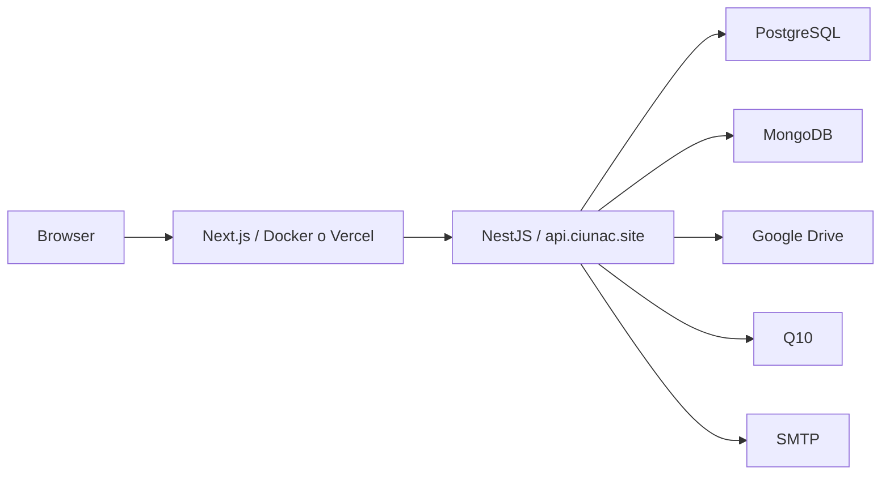
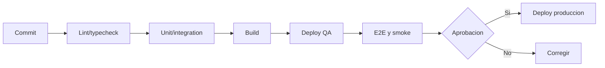

# 15 - Deployment

## Topologia



## Ambientes

| Ambiente | Objetivo | Datos |
| --- | --- | --- |
| Local | desarrollo | fixtures/no productivos |
| QA/Staging | aceptacion e integracion | datos sanitizados |
| Produccion | operacion CIUNAC | datos reales y auditoria |

## Configuracion frontend

- `NEXT_PUBLIC_API_URL`: publica.
- `NEXT_PUBLIC_API_KEY`: publica; no es secreto de usuario.
- `AUTH_SECRET`: secreto de NextAuth.
- `NEXT_PUBLIC_EXCEPTION_USER`: excepcion existente que debe auditarse antes de produccion.

## Docker frontend

Ejecuta los comandos desde la raiz del repositorio. Usa la URL HTTPS de la API del ambiente, accesible desde el navegador y el contenedor, incluido su prefijo si corresponde. Para la prueba local abre `http://localhost:3000`, que ya esta permitido por el CORS del backend.

Prepara un archivo local `.env.docker` en formato `CLAVE=valor`, sin comillas. Incluye `AUTH_SECRET`, `AUTH_URL=http://localhost:3000` para la prueba local y `NEXT_PUBLIC_API_URL`, `NEXT_PUBLIC_API_KEY` y, si aplica, `NEXT_PUBLIC_EXCEPTION_USER`. Para Estudiantes, configura tambien `API_URL`, `API_KEY`, `API_KEY_Q10` y el `APP_BASE_URL` del portal; `Q10_API_URL` es opcional. Los archivos `.env*` quedan fuera del contexto de build.

### Desarrollo

```powershell
docker build -f Dockerfile.dev -t ciunac-admin:dev .
docker run --rm -it --env-file .env.docker -p 127.0.0.1:3000:3000 --mount "type=bind,source=${PWD},target=/app" --mount "type=volume,target=/app/node_modules" --mount "type=volume,target=/app/.next" ciunac-admin:dev
```

Los volumenes mantienen las dependencias y la compilacion de Linux separadas de las del host. Tras cambiar el manifiesto, el lockfile o los parches, deten el contenedor y vuelve a ejecutar ambos comandos para obtener volumenes nuevos.

### Produccion

Define `NEXT_PUBLIC_API_URL`, `NEXT_PUBLIC_API_KEY` y, si aplica, `NEXT_PUBLIC_EXCEPTION_USER` en el entorno de la terminal antes del build. Next.js incorpora estos valores en el bundle. Un cambio requiere reconstruir la imagen. Pasa los secretos exclusivamente al arrancar el contenedor.

```powershell
docker build --build-arg NEXT_PUBLIC_API_URL --build-arg NEXT_PUBLIC_API_KEY --build-arg NEXT_PUBLIC_EXCEPTION_USER -t ciunac-admin:prod .
docker run --rm --env-file .env.docker -p 127.0.0.1:3000:3000 ciunac-admin:prod
```

El build aplica el parche de Textkit y ejecuta la regresion de los 100 PDFs. La imagen final sirve la salida standalone de Next.js como usuario `node`. Para alternar entre desarrollo y produccion, deten primero el contenedor que usa el puerto 3000.

### Integracion posterior con Compose

- Configura `build.context` con la ruta relativa al directorio del frontend. Selecciona `Dockerfile` o `Dockerfile.dev` mediante `build.dockerfile`.
- En produccion, pasa `NEXT_PUBLIC_*` por `build.args` y la configuracion de arranque por `env_file`. En desarrollo, pasa todas las variables por `env_file` y monta el codigo y los dos volumenes indicados arriba.
- Con Traefik, conecta el servicio a `traefik_net` y dirige el balanceador al puerto interno `3000`. Si Compose se ejecuta en un proyecto separado, declara la red existente como externa. Publica el dominio mediante Traefik y deja el puerto del contenedor sin mapeo al host.
- Define `AUTH_URL` y `APP_BASE_URL` con el origen HTTPS final del portal y verifica que el backend incluya ese origen en su CORS.

## Configuracion backend

- PostgreSQL: host, port, user, password y database.
- MongoDB: URI.
- JWT: access secret.
- API Key del backend.
- Google OAuth/refresh token y carpetas Drive.
- Credenciales SMTP por tipo de correo.
- Credenciales Q10.
- CORS y habilitacion de Swagger por ambiente.

No se documentan valores secretos.

## Pipeline



## Orden de despliegue

1. Backup y migraciones compatibles.
2. Backend backward-compatible.
3. Smoke de API y guards.
4. Frontend.
5. Smoke por rol y flujo critico.
6. Retiro posterior de contratos obsoletos.

## Smoke tests

- Login de los tres roles.
- Permiso permitido y denegado.
- Contexto docente completo y ausente.
- Consulta de usuarios, estructura y grupos.
- Registro/listado de solicitud en ambiente controlado.
- Preview/upload no destructivo de documento.
- Examen y seguimiento docente.

## Rollback

- Mantener artefactos frontend/backend anteriores.
- Migraciones incluyen `down` o procedimiento probado.
- Evitar rollback backend si una migracion destructiva ya fue usada.
- Deshabilitar feature o revertir frontend cuando el contrato siga compatible.
- Registrar version, hora, responsable y motivo.

## Brechas

- `GAP-DEP-001`: CORS esta codificado en backend.
- `GAP-DEP-002`: no se encontro pipeline CI compartido en el frontend.
- `GAP-DEP-003`: propietario y plataforma exacta del backend no estan documentados.
- `GAP-DEP-004`: estrategia formal de migraciones y rollback requiere aprobacion operativa.
